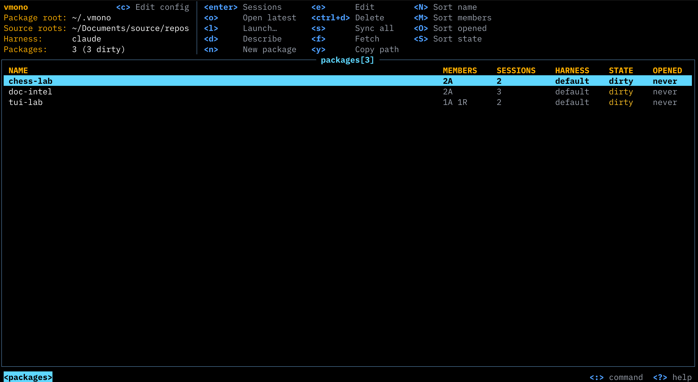

<p align="center">
  <br>
  <strong><code>vmono</code></strong><br>
  Many repos. One workspace for your coding agent.<br>
  <a href="https://github.com/doneill612/vmono/releases/latest"></a>
  <a href="https://github.com/doneill612/vmono/actions/workflows/ci.yml"></a>
  <a href="LICENSE"></a><br>
  
</p>

---

vmono manages **packages** and their **sessions**. A package is a set of git repos defined once, with a purpose that explains why they belong together. A session is one piece of work on a package: its own branch, and a directory holding a git worktree of every member, which a coding harness opens and sees all of them. It replaces the habit of copying repos out of `~/source/` into a temporary parent folder.

- A package is defined once. Starting more work on the same set of repos is a new session, not a new package, so nothing about the members is set up twice.
- Members are **git worktrees** of repos already on your machine: no copies, no re-clones, shared object storage.
- The package's purpose, context, notes and each member's role are written once and rendered into every session's `AGENTS.md` / `CLAUDE.md`.
- A harness opened at a session root works with no changes. Claude Code, OpenCode, Codex and Pi work out of the box; Claude Code and OpenCode also get generated config, and Codex and Pi get the skill.
- A skill teaches the harness running inside a session to read the package, and to write back to it only what every future session needs. Claude Code gets it as a [plugin](docs/claude-code-plugin.md) that also adds commands and live session state.
- Runs on macOS, Linux and Windows, without admin rights.

## Install

macOS and Linux:

```sh
curl -fsSL https://github.com/doneill612/vmono/releases/latest/download/install.sh | sh
```

Windows (PowerShell):

```powershell
irm https://github.com/doneill612/vmono/releases/latest/download/install.ps1 | iex
```

This installs `vmono` to `~/.local/bin` (`%LOCALAPPDATA%\Programs\vmono\bin` on Windows), so make sure that is on your `PATH`. Requires git 2.30 or newer. Check with `vmono --version`.

To pin a version, change the install location, build from source, or uninstall, see [Installation](docs/installation.md).

## Quick start

```sh
vmono                      # opens the TUI; first run walks you through setup
```

Or from the command line:

```sh
vmono init --source-root ~/source
vmono new project --active member-a,member-b --ref member-c \
    --purpose-file purpose.md --session token-refresh
vmono open project/token-refresh   # launches your default harness at the session root

vmono session new project spike    # more work on the same repos: a new session
```

When the work is done, `vmono session finish` lands each member's commits on a branch in its source repo, and `vmono session push` publishes them. Nothing is pushed unless you ask.

Add `eval "$(vmono shell-init zsh)"` (or `bash`, `fish`, `pwsh`) to your shell rc for a `vcd <pkg>[/session]` function.

## Key ideas

- **Package**: the members (source repos), a purpose, context, notes and a role per member. Defined once, shared by every session.
- **Session**: one piece of work: its own branch and a worktree of every member. A harness opens it.
- **Active members** are checked out on the session branch and can be edited; **reference members** are detached at a fixed ref under `_ref/` and are read-only.

See [Concepts](docs/concepts.md) for the full vocabulary and what a package looks like on disk.

## Documentation

| Topic | What's in it |
| --- | --- |
| [Installation](docs/installation.md) | Install script options, building from source, uninstalling |
| [Concepts](docs/concepts.md) | Packages, sessions, members, landing branches, and the layout on disk |
| [The TUI](docs/tui.md) | Views, the command palette, and every shortcut |
| [Working with sessions](docs/sessions.md) | Updating, finishing and pushing a session; migrating older packages |
| [Initializing a package](docs/package-init.md) | Have an agent explore the members and record an overview |
| [Setup, teardown and hooks](docs/setup-and-teardown.md) | Install dependencies per worktree; run commands around session events |
| [The Claude Code plugin](docs/claude-code-plugin.md) | The skill, commands and live state each session gets |
| [Integrations](docs/integrations.md) | Run each session in its own tmux session or herdr workspace |
| [Command reference](docs/commands.md) | Every command, and exit codes |
| [Configuration](docs/configuration.md) | `config.toml`, harnesses and adapters, git authentication |
| [Safety](docs/safety.md) | What vmono never does, and what your harness enforces |
| [Development](docs/development.md) | Building, testing and releasing |
